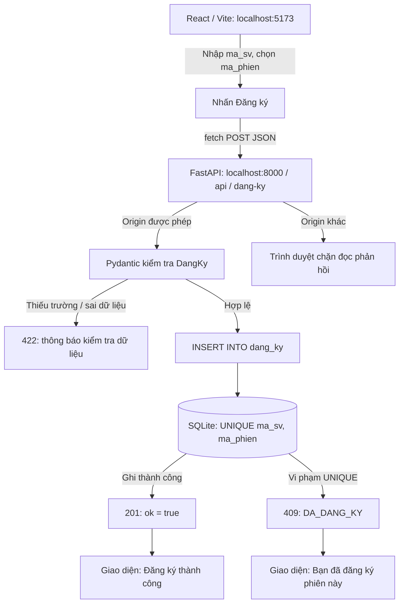

# Sơ đồ cổng đăng ký Ngày hội việc làm

Mã sinh viên: 23110198. Bài thực hành CSE3051 — Buổi 3.

Giao diện khởi đầu ở trạng thái chưa gửi. Trong lúc gửi, khóa form/nút và hiển
thị đang gửi. Khi nhận HTTP 201 hoặc 409, hiện thông báo tương ứng và giữ dữ liệu
để có thể gửi lại. Thay đổi dữ liệu đưa form về trạng thái chưa gửi. Lỗi 422,
lỗi máy chủ, lỗi mạng hay timeout có thông báo riêng.

CORS là kiểm soát origin của trình duyệt, không phải cơ chế xác thực. Ràng buộc
UNIQUE của SQLite đảm bảo một cặp mã chỉ được ghi một lần ngay cả khi nhiều
yêu cầu đến đồng thời. Khởi động lại không làm mất dữ liệu đăng ký.

Ảnh sơ đồ độc lập: [so-do.svg](so-do.svg).
